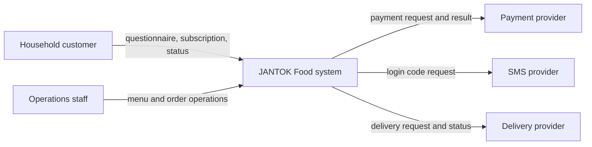
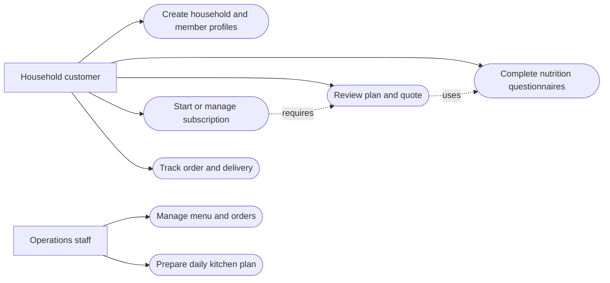
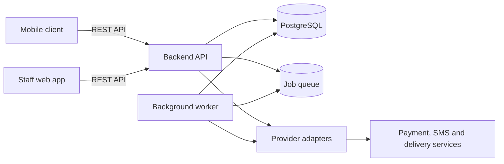

# Architecture — initial draft

Owner: Balgyn. YouTrack: JANTOK-7. These diagrams are draft design artifacts. Components and provider choices remain subject to requirements validation and technology comparison.

## System context

The household customer and operations staff interact with JANTOK. External payment, SMS and delivery providers are dependencies, not claimed live integrations.

Editable source: [context.mmd](../diagrams/context.mmd).

## Use cases

Editable source: [use-cases.mmd](../diagrams/use-cases.mmd). Use-case labels are preliminary and map to FR-01 through FR-06 in [REQUIREMENTS.md](REQUIREMENTS.md).

## Components

Editable source: [components.mmd](../diagrams/components.mmd). The API owns pricing, restrictions, authorization and order state. The mobile and staff clients display server decisions. Database, queue and adapters are conceptual until the technology decision is reviewed.

Readable exports are the rendered diagrams in this Markdown file. A separate SVG/PDF export may be added with the reviewed submission.
