# Architecture and diagrams — version 1.0

Date: 23 October 2026. YouTrack: JANTOK-7. The views describe the target system and align with requirements version 1.0. Editable Mermaid sources and readable SVG exports live together in [diagrams](../diagrams/).

## System context

[Editable source](../diagrams/context.mmd) · [SVG export](../diagrams/context.svg)

Households access the mobile application; kitchen/operations staff access the web frontend. JANTOK covers one kitchen and Astana. Payment, SMS and delivery providers are external systems. The context shows their intended interfaces, not active integrations in this submission.

## Use cases

[Editable source](../diagrams/use-cases.mmd) · [SVG export](../diagrams/use-cases.svg)

The household owner manages members, restrictions, menu/quote, subscription changes and delivery information (FR-01–05). Staff maintain menus/orders and produce a kitchen plan (FR-06/08). Authentication and role authorization (FR-07) are preconditions for private use cases. Restriction evaluation is reused by menu selection; a visible quote precedes subscription confirmation.

## Component view

[Editable source](../diagrams/components.mmd) · [SVG export](../diagrams/components.svg)

Flutter mobile and Next.js staff frontend call the NestJS API using HTTP JSON/OpenAPI. The API owns business rules and household/role checks. PostgreSQL/Prisma stores authoritative state. A worker and Redis/BullMQ handle background jobs when introduced; provider adapters isolate SMS, payment and delivery services. This is a modular monolith with a separate worker process, not a set of independent microservices.

## Responsibilities and data

| Boundary | Responsibility | Main data / requirements |
| --- | --- | --- |
| Mobile → API | Authenticate owner; manage separate profiles/questionnaires; show eligible meals, quote/calendar and status | Household, Member, Questionnaire, Restriction; FR-01–05/07 |
| Staff frontend → API | Maintain menu data, update authorized status and request daily kitchen plan | Meal/Ingredient/Allergen, MenuVersion, Order; FR-05/06/08 |
| API → PostgreSQL | Preserve ownership and linked state; version inputs for reproducible decisions | QuoteSnapshot, Subscription, MealSelection, StatusEvent; NFR-01/02 |
| Worker → queue/store/adapters | Process a job once logically, retain retries/source, never bypass API-domain rules | Job/Event and provider reference; NFR-02 |
| Provider boundary | Translate third-party events into checked internal transitions | Payment/delivery reference; contracts pending |

Household → Member is one-to-many; a member has versioned answers/restrictions. A quote records quantities, integer KZT prices, period and rule version. A confirmed subscription references its quote and selected menu snapshot. Orders belong to the household and retain authorized status events. Staff access uses a role boundary rather than household ownership.

## Main scenario

1. An authenticated owner saves two members and their different restrictions.
2. The API checks ingredient declarations and returns eligible options with reasons for exclusions.
3. The owner selects a 30-day plan and inspects the itemized quote before confirming.
4. Confirmation preserves the quote/menu snapshots; a repeated request is idempotent.
5. A permitted replacement is accepted only before the business deadline.
6. Staff receive the daily plan and update fulfillment; the correct household sees the status.

[Requirements](REQUIREMENTS.md), [UX](UX_PROTOTYPE.md), [decisions](DECISIONS.md) and [test cases](../tests/test-cases.csv) use the same component responsibilities. Source placement is documented in [src](../src/). Pricing, nutrition, provider contracts and operational rules require stakeholder confirmation before real service use.
