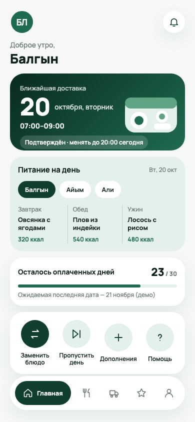
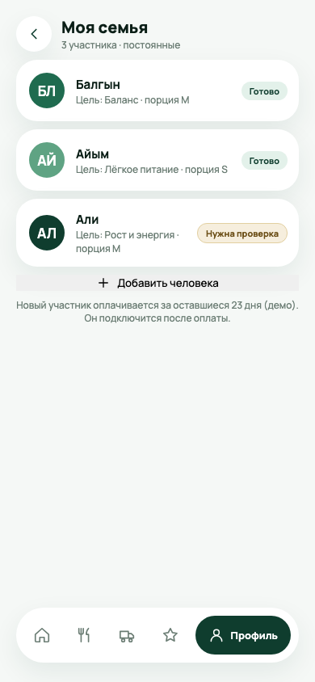
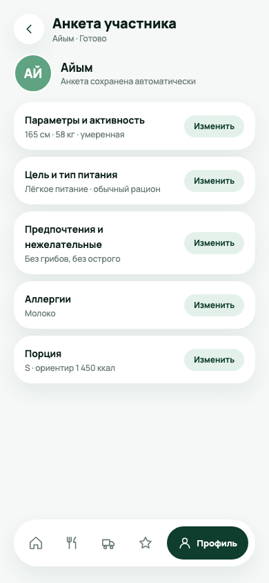
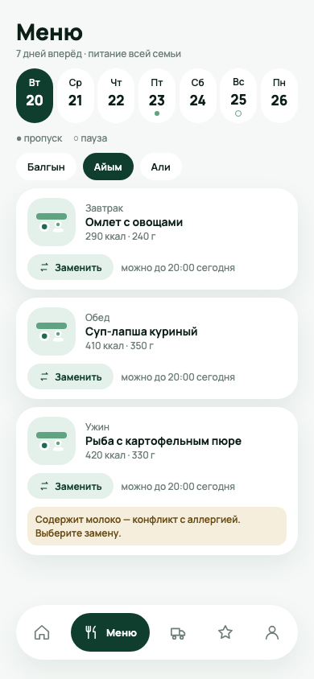
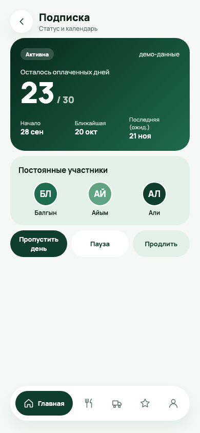
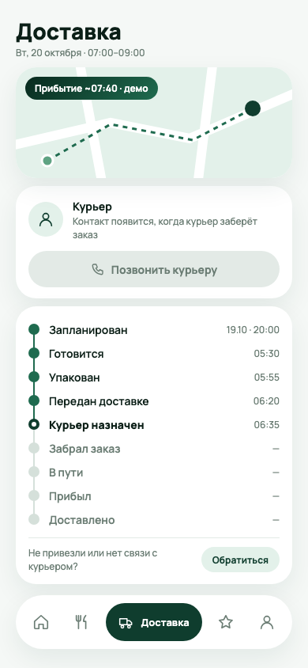

# UX prototype — six mobile scenarios

JANTOK-8. The six screenshots below are static design previews (390 × 844), not captured behavior of the diploma starter application. Their editable HTML files are in [prototype/screens](../prototype/screens/), with PNG exports in [prototype/previews](../prototype/previews/). The source was selected from the user-provided jantok-food-design.zip archive (19 October 2026). The archive's original design authorship is not established here; the team should confirm provenance before presenting it as original student design. We changed only synthetic UI persona text from “Диас” to “Балгын” and initials from “ДС” to “БЛ”; this is not an authorship credit change. The example dates, prices and subscription state are demo data.

| Scenario | Editable source | Preview | Requirement |
| --- | --- | --- | --- |
| Home: next delivery and daily meals | [01-home.html](../prototype/screens/01-home.html) | [PNG](../prototype/previews/01-home.png) | FR-04/05 |
| Household: separate members | [02-family.html](../prototype/screens/02-family.html) | [PNG](../prototype/previews/02-family.png) | FR-01 |
| Member questionnaire and allergy | [03-questionnaire.html](../prototype/screens/03-questionnaire.html) | [PNG](../prototype/previews/03-questionnaire.png) | FR-02 |
| Seven-day menu and replacement | [04-menu.html](../prototype/screens/04-menu.html) | [PNG](../prototype/previews/04-menu.png) | FR-04 |
| Subscription summary | [05-subscription.html](../prototype/screens/05-subscription.html) | [PNG](../prototype/previews/05-subscription.png) | FR-03/04 |
| Delivery timeline | [06-delivery.html](../prototype/screens/06-delivery.html) | [PNG](../prototype/previews/06-delivery.png) | FR-05 |

## Preview gallery

## Planned usability walkthrough

Ask a participant to add two members, set a restriction for one, choose an alternative meal, find the subscription period/price, and locate today's delivery status. Observe errors and time to completion without coaching. The previews show only some of those states; quote detail and real error handling require further design. No usability sessions or user approval are claimed yet.

To regenerate a preview locally, open its HTML in a 390 × 844 browser viewport and take a screenshot. The HTML uses a Google Fonts stylesheet; if offline, the layout may use the system fallback font.
