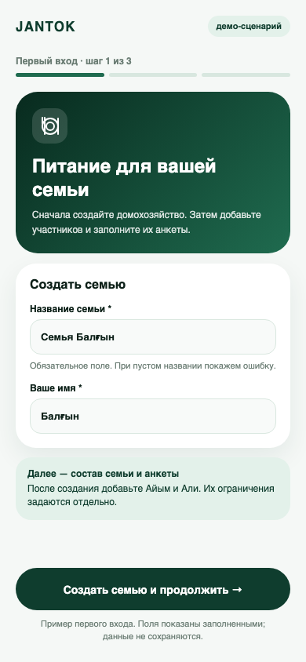
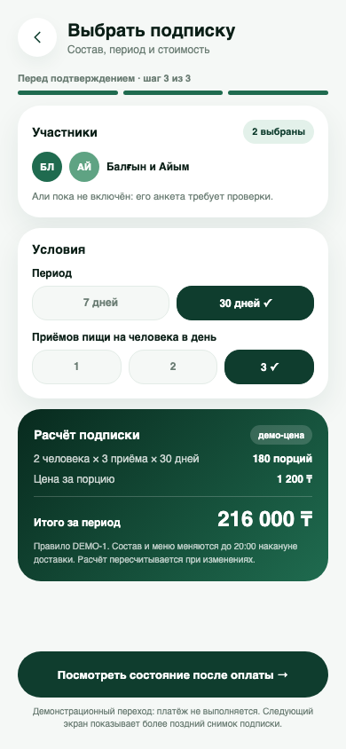

# UX prototype — version 1.1

Date: 24 October 2026. YouTrack: JANTOK-8. Eight static mobile previews (390 × 844) cover the key household scenarios. Editable HTML is in [prototype/screens](../prototype/screens/); readable PNG exports are in [prototype/previews](../prototype/previews/). The original six previews (01–06) came from the user-provided jantok-food-design.zip archive. The team confirmed on 23 October 2026 that the archive was created for JANTOK and may be used in the diploma. Two supplementary screens (00 and 04a) were prepared with Codex assistance on 24 October to show the previously missing first-use and subscription-selection states; they do not establish individual student design authorship. The example persona is Balgyn; names, dates, prices and account states are synthetic demonstration content.

| Scenario | Editable source | Preview | Requirement |
| --- | --- | --- | --- |
| First use: create a household | [00-onboarding.html](../prototype/screens/00-onboarding.html) | [PNG](../prototype/previews/00-onboarding.png) | FR-01 |
| Home: next delivery and daily meals | [01-home.html](../prototype/screens/01-home.html) | [PNG](../prototype/previews/01-home.png) | FR-04/05 |
| Household: separate members | [02-family.html](../prototype/screens/02-family.html) | [PNG](../prototype/previews/02-family.png) | FR-01 |
| Member questionnaire and allergy | [03-questionnaire.html](../prototype/screens/03-questionnaire.html) | [PNG](../prototype/previews/03-questionnaire.png) | FR-02 |
| Seven-day menu and replacement | [04-menu.html](../prototype/screens/04-menu.html) | [PNG](../prototype/previews/04-menu.png) | FR-04 |
| Select a subscription and inspect the quote | [04a-plan-selection.html](../prototype/screens/04a-plan-selection.html) | [PNG](../prototype/previews/04a-plan-selection.png) | FR-03 |
| Subscription summary | [05-subscription.html](../prototype/screens/05-subscription.html) | [PNG](../prototype/previews/05-subscription.png) | FR-03/04 |
| Delivery timeline | [06-delivery.html](../prototype/screens/06-delivery.html) | [PNG](../prototype/previews/06-delivery.png) | FR-05 |

## Preview gallery

## Scenario specification and usability walkthrough

Ask a participant to create a household, add two members, set a restriction for one, choose an alternative meal, select a subscription period, find the itemized quote, and locate today's delivery status. Observe errors and time to completion without coaching. The previews show the key happy path and selected caution states; actual form validation, payment, persistence and user testing remain future work. No usability sessions or user approval are claimed yet.

To regenerate a preview locally, open its HTML in a 390 × 844 browser viewport and take a screenshot. The HTML uses a Google Fonts stylesheet; if offline, the layout may use the system fallback font.

## End-to-end storyboard

Precondition: the household owner has signed in. This is a conceptual path through synthetic snapshots, not a claim that the static screens share live data.

1. At [first use](../prototype/screens/00-onboarding.html), enter the required household name and owner name; the primary link opens the [family](../prototype/screens/02-family.html) screen. An empty name blocks creation with an inline error, while a signed-out user is prompted to sign in. The family screen is a later demo snapshot with the owner and two added members.
2. Choose Aйым in the [family](../prototype/screens/02-family.html) list and open her [questionnaire](../prototype/screens/03-questionnaire.html). The questionnaire labels member-specific preferences, milk allergy and editable inputs. Ali's pending verification is visible in the family list.
3. In [menu](../prototype/screens/04-menu.html), check the selected member and the milk-conflict warning. A conflicting item must be replaced before confirmation; an unknown ingredient is treated as blocked until checked. The static menu illustrates the warning, not the persisted replacement.
4. At [plan selection](../prototype/screens/04a-plan-selection.html), choose the 30-day period and three meals per member per day for the two eligible members. Inspect the itemized quote, price-rule version and change deadline before simulated confirmation. Ali is excluded while his questionnaire needs verification. Changing period, meal count or members recalculates the quote; zero eligible members blocks confirmation.
5. The selection screen's demo link shows an [active subscription](../prototype/screens/05-subscription.html) after a simulated payment. That existing archive screen is a **later, separate synthetic snapshot** where Ali has been added; it must not be read as the exact result of the two-member quote. Open [home](../prototype/screens/01-home.html), then [delivery](../prototype/screens/06-delivery.html) to locate the current order status.

The document links every screen in order. The two new screens also link to the next stage; buttons in the original six HTML mockups remain visual controls. No payment is executed and no data is persisted.

## Quote detail required by FR-03

The [selection preview](../prototype/previews/04a-plan-selection.png) now shows the two-member synthetic evaluation fixture: 2 members × 3 meals/member/day × 30 days = 180 portions; at 1200 KZT/portion the total is 216000 KZT. It labels the provisional DEMO-1 price rule and the change deadline. This is not a commercial tariff or a payment offer. The existing subscription-summary preview illustrates a later three-member state rather than the result of this exact quote. Error handling and recalculation are specified in the storyboard but not implemented by the static HTML.

## Staff interaction for FR-05/06/08

A staff member signs in, selects the kitchen date, reviews meal quantities/restriction notes and updates authorized fulfillment status. The staff interface is a planned Next.js component in src/frontend; no standalone demo dashboard is needed for this analysis submission.

| Selected date (synthetic) | Household | Members | Meals | Required information |
| --- | --- | --- | --- | --- |
| 2 November 2026 | SYN-HH-A | 2 | 6 | Member meal selections, restriction reasons and current order status |

Changing the date filters this plan. Updating a status persists through the API and becomes visible only to the owning household. Customer accounts cannot access the kitchen view or maintain ingredient declarations. Empty-plan, invalid-date and denied-access states must be explicit. See TC-08/09/10/12 for expected behavior.

Static screens establish the intended interaction; they do not demonstrate persistence, accessibility compliance, successful user testing or implemented business rules. Usability findings will be recorded with the real session date and resulting screen/requirement changes.
